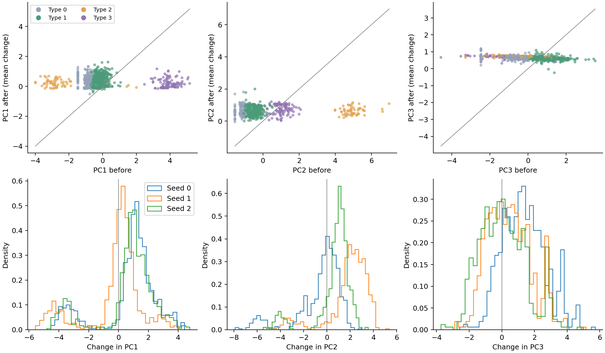
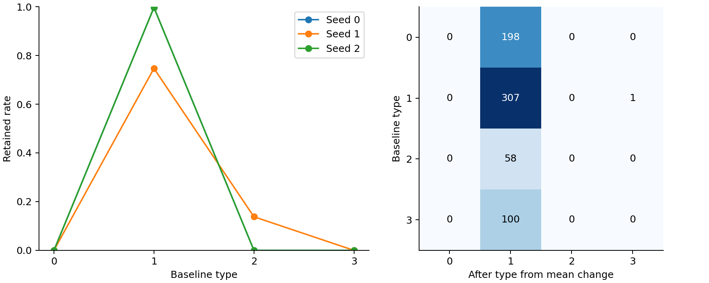

# 原始联合 Ridge 思路下的供给变化与种子一致性

已完成原始实现核对、三个通道提取、九维联合解码、固定 PC 变化和 retained/changed 识别，以及三个随机种子的一致性检验。当前结果来自 E3_w1 的种子 0、1、2。

## 联合解码与固定 ruler

原始联合解码在 5lineb/v10_edgedisen/consensus_v10.py 中实现，gnnexplainer_contrib_v13.py 使用相同思路。common/decode.py 提供 RidgeCV 的 15 个候选正则化参数，范围为 10⁻⁴ 至 10³。联合解码器在聚合前的拼接表示 S 上拟合九维标准化供给指标 X。

\[
D\colon S\mapsto X,\qquad \Delta x=D(C)-D(S),\qquad X_{after}=X+\Delta x.
\]

这里 C 为聚合后表示。同一个解码器应用于前后表示，截距和共同的基线重建误差在差分中抵消。没有分别拟合前后解码器，也没有用 D(C) 与 X 的直接差值替代联合差分。

当前 MechanismNet 输出三个 32 维通道。聚合后表示严格使用模型实际输出。

\[
C_i=[h_i^{base}\Vert h_i^{comp}\Vert h_i^{compete}].
\]

当前模型没有旧模型中可直接调用的三通道 self loop 向量。本次明确构造本地消息参照，沿用当前消息映射的参数和坐标空间。

\[
S_i=[h_i^{base}\Vert V_{comp}(x_i)\Vert V_{compete}(x_i,t_{ii},\mathrm{onehot}(R_{ii}))].
\]

距离和拓扑使用模型自己的对角输入。本地 base 与其当前流量上下文在 S 和 C 中相同，变化来自两个外部通道的表示替换。S 是本次对当前架构的显式适配，并非当前模型原生输出的完整聚合前张量。没有新增通道归一化或改变门值、注意力和消息映射。旧模型中的 L2 处理属于其表示构造，本次保留当前模型原生通道尺度。

描述性主分析使用全部阈值后有向 OD 边，参数冻结。另核对归档测试上下文的预测得分逐值一致，并报告测试上下文与完整图上下文的差值敏感性。

固定 ruler 为重做实验/step3_od_demand_outpatient/results/node_typing/ruler.json。沿用九指标顺序、变换、标准化参数、3 个 PC 投影、4 类聚类中心和类别名称。未重新拟合 PCA 或 K-means。

\[
PC_{before}=XU,\quad PC_{after}=(X+\Delta x)U,\quad \Delta PC=\Delta xU.
\]

四类依次为稀缺型、社康主导型、三甲二级型、三甲社康型。PC1 主要具有三甲正载荷和二级负载荷，PC2 主要具有二级正载荷，PC3 主要具有社康正载荷和三甲负载荷。PC 分数上升不能统一解释为所有供给维度改善。

## 九维重建

采用仓库原有 5 个空间折。每折只使用其余节点拟合 RidgeCV，再预测留出节点。编码器与 ruler 已使用全市输入，因此这是冻结表示的空间留出解码验证。主分析解码器随后在全部节点的 S 上拟合，符合原始联合解码实现。所有种子和空间折均选择 alpha 为 0.0001。

| 种子 | 九维留出 RMSE | 最低单指标留出 R² | 基线类型重建一致率 | 留出解码与全样本解码的变化后类型一致率 |
| --- | ---: | ---: | ---: | ---: |
| 0 | 0.01070 | 0.999536 | 100% | 100% |
| 1 | 0.01238 | 0.999402 | 100% | 100% |
| 2 | 0.00858 | 0.999639 | 100% | 100% |

这些数值说明聚合前表示能够准确还原九项输入。两个本地消息映射本身读取九项指标，重建精度高与这一结构有关。该检验不提供互动调整后供给的独立观测验证。

## PC 升降与类型变化

逐节点输出覆盖 666 个节点，主统计排除 2 个零出流节点，使用 664 个有流量节点。零流量节点的代数结果仍保留，eligible 字段为 false。

| 种子 | retained | changed | 平均 ΔPC1 | 平均 ΔPC2 | 平均 ΔPC3 |
| --- | ---: | ---: | ---: | ---: | ---: |
| 0 | 307 | 357 | 0.7445 | −0.5966 | 1.3612 |
| 1 | 238 | 426 | −0.2260 | 1.8612 | 0.4588 |
| 2 | 307 | 357 | 0.5769 | 0.6163 | 0.0940 |



664 个节点中，PC1、PC2、PC3 升降符号在全部三个种子下相同的节点分别为 514、383、431 个，对应 77.4%、57.7%、64.9%。PC1 的方向一致性较高，PC2 对种子更敏感。各轴连续变化的跨种子 Pearson 相关较高，但整体偏移仍可使升降符号改变，因此相关系数不能替代方向一致率。

类型变化使用固定四类中心。三个种子均值给出 307 个 retained 和 357 个 changed。沿用原始至少 80% 种子同意的规则，三个种子时需全部同意，得到 230 个稳健 retained 和 282 个稳健 changed，另有 152 个节点的具体变化后类型不完全一致。

| 一致性指标 | 节点数 | 比例 |
| --- | ---: | ---: |
| 三种子 retained/changed 状态一致 | 579 | 87.2% |
| 三种子具体变化后类型一致 | 512 | 77.1% |
| 稳健 retained | 230 | 34.6% |
| 稳健 changed | 282 | 42.5% |



需要同时报告类型集中。种子 0、2 各有 663 个节点归入社康主导型，种子 1 有 512 个社康主导型和 152 个三甲二级型。均值结果有 663 个社康主导型和 1 个三甲社康型。种子 0 与 1 的类别直接一致率为 77.1%，但 ARI 仅为 0.0071，表明表面一致率受到主导类别占比影响。因此不能只用 77.1% 宣称类型结构已稳定，也不能把向单一类型集中直接解释为韧性提升。

本次完成了声明的本地参照下的模型估计供给变化。基线重建可靠，类型变化并未完全跨种子一致，PC2 和 PC3 的升降仍应逐种子保留。两个机制通道的差分贡献只表示模型中的通道替换，不作为已识别的真实补偿或竞争效应。

## 文件与复核

完整包 complete_results.zip 包含逐节点九项 before、decoded_before、decoded_after、after、delta、空间留出预测、PC 前后与方向、类型与一致性结果，以及每个种子的 h_base、h_comp、h_compete、S、C、Ridge 系数和通道差分。

reconstruction.csv 保存单指标性能，seed_pair_consistency.csv 保存跨种子相关、方向一致率、类型一致率和 ARI。node_seed_consistency.csv 可直接筛选稳健 retained、稳健 changed 和不一致节点。type_summary.csv 与 type_transition.csv 分别给出分组统计和各种子转换矩阵。

数值核对包括归档预测重放、相同表示差分为零、线性差分恒等式、通道贡献可加、本地 base 差分为零，以及固定 PC 和类型中心。测试上下文与全图上下文的变化后类型一致率为 99.40% 至 99.85%，详见 graph_context_sensitivity.csv。

在仓库根目录执行以下命令。输出目录须不存在。

```bash
python 5lineb/v13_geoflow/analyze_joint_ridge_v13.py --output /path/to/new_results
```
