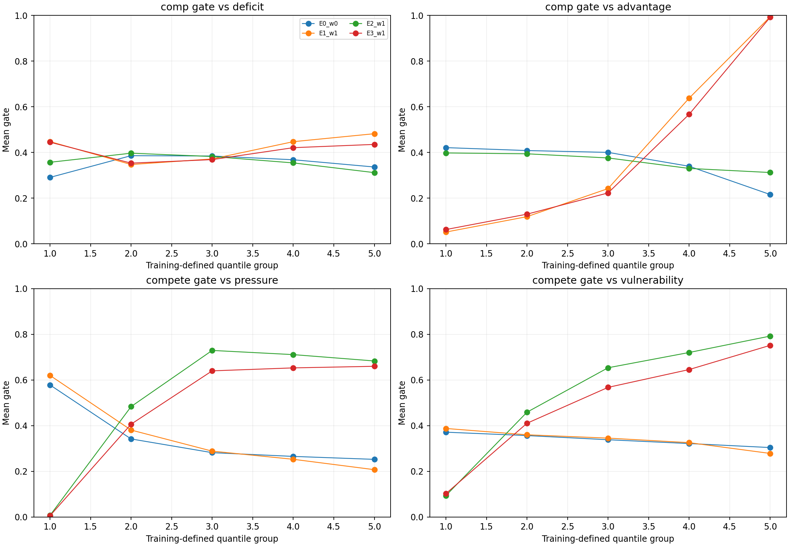
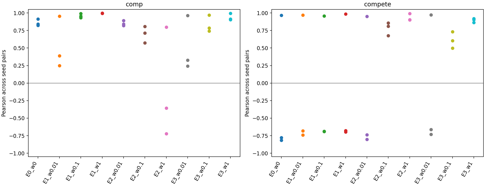
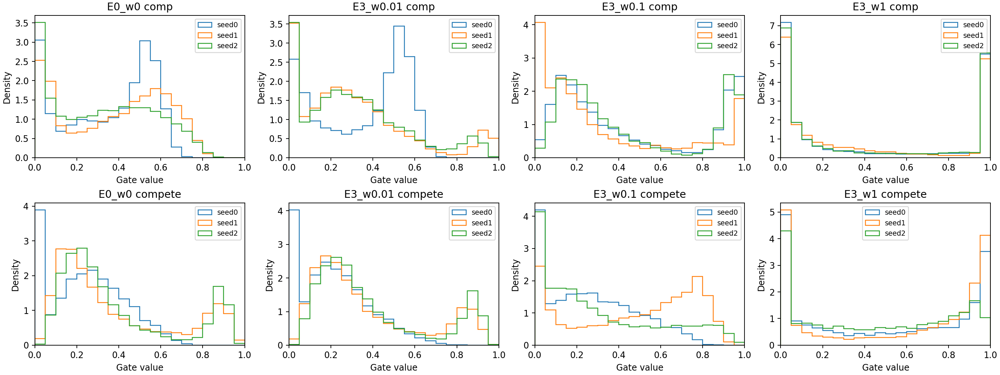

# 门控弱机制检验结果

本轮完成 30 次训练。权重 1 的双约束将测试留出 OD 上的补偿门与竞争门跨种子平均相关性分别提高至 0.9373 和 0.8962，E0 对应值为 0.8597 和 −0.2086。测试 CE 从 3.8190 变为 3.8357。竞争门对起点压力与脆弱性的响应得到改善，补偿门对目的地相对优势的响应得到改善，但起点缺口响应没有在所有种子上通过，因此双机制可识别性尚未全面通过。

同一起点内的配对更容易约束目的地相对优势，可能不足以约束不同起点之间的缺口响应。这是由当前配对结构与结果作出的解释，未作为已验证的因果结论。

竞争门采用起点受外来流入压力而外流的口径。两个门保持独立 sigmoid，允许同一 OD 同时激活。GATv2、三通道拼接、目的地预测头及固定数据拆分保持原样。

以下均为实际完成的三种子实验。E0 为当前环境重新训练的 M1。E1 仅补偿排序约束，E2 仅竞争排序约束，E3 同时加入两项约束。权重网格为 0.01、0.1、1，E3 使用相同权重的三个组合。

## 预测指标

| 设置 | CE 均值 ± SD | CPC 均值 ± SD | NRMSE 均值 ± SD |
|---|---|---|---|
| E0_w0 | 3.8190 ± 0.0092 | 0.6833 ± 0.0011 | 4.1235 ± 0.0072 |
| E1_w0.01 | 3.8055 ± 0.0141 | 0.6848 ± 0.0045 | 4.0987 ± 0.0666 |
| E1_w0.1 | 3.8024 ± 0.0154 | 0.6876 ± 0.0033 | 4.0435 ± 0.0446 |
| E1_w1 | 3.8117 ± 0.0049 | 0.6850 ± 0.0013 | 4.1742 ± 0.0856 |
| E2_w0.01 | 3.8043 ± 0.0129 | 0.6864 ± 0.0041 | 4.1018 ± 0.0773 |
| E2_w0.1 | 3.8130 ± 0.0073 | 0.6853 ± 0.0016 | 4.0913 ± 0.0859 |
| E2_w1 | 3.8159 ± 0.0169 | 0.6836 ± 0.0058 | 4.0593 ± 0.0761 |
| E3_w0.01 | 3.8057 ± 0.0143 | 0.6860 ± 0.0051 | 4.0944 ± 0.0696 |
| E3_w0.1 | 3.8175 ± 0.0060 | 0.6818 ± 0.0022 | 4.1297 ± 0.0342 |
| E3_w1 | 3.8357 ± 0.0231 | 0.6776 ± 0.0071 | 4.1801 ± 0.1499 |

## 门与代理的响应

使用验证留出 OD 的门值。代理只由可见训练图构造。每个门分别报告对补偿代理和竞争代理的匹配排序一致率。数值为三个种子的均值。

| 设置 | 补偿门对补偿 | 补偿门对竞争 | 竞争门对补偿 | 竞争门对竞争 |
|---|---:|---:|---:|---:|
| E0_w0 | 0.1439 | 0.7647 | 0.4142 | 0.3745 |
| E1_w0.01 | 0.3068 | 0.7639 | 0.3718 | 0.3805 |
| E1_w0.1 | 0.9106 | 0.7609 | 0.2914 | 0.3878 |
| E1_w1 | 0.9281 | 0.6135 | 0.3923 | 0.3689 |
| E2_w0.01 | 0.1423 | 0.7435 | 0.4175 | 0.3936 |
| E2_w0.1 | 0.2626 | 0.7672 | 0.8238 | 0.8089 |
| E2_w1 | 0.2879 | 0.5513 | 0.5640 | 0.9476 |
| E3_w0.01 | 0.3303 | 0.7504 | 0.3452 | 0.3945 |
| E3_w0.1 | 0.9188 | 0.6837 | 0.5911 | 0.8085 |
| E3_w1 | 0.9308 | 0.6194 | 0.4276 | 0.9364 |

## 固定门语义的跨种子稳定性

以下使用测试留出 OD，未交换门标签。相关系数和差异均按 OD 等权计算。完整数据同时包含验证留出 OD 与可见非测试 OD。

| 设置 | 种子对 | 补偿相关 | 竞争相关 | 补偿 MAD | 竞争 MAD |
|---|---|---:|---:|---:|---:|
| E0_w0 | 0、1 | 0.8430 | -0.7774 | 0.0962 | 0.3398 |
| E0_w0 | 0、2 | 0.9136 | -0.8146 | 0.0761 | 0.3330 |
| E0_w0 | 1、2 | 0.8224 | 0.9662 | 0.1012 | 0.0534 |
| E1_w0.01 | 0、1 | 0.2494 | -0.6799 | 0.2003 | 0.2992 |
| E1_w0.01 | 0、2 | 0.3898 | -0.7397 | 0.1631 | 0.3330 |
| E1_w0.01 | 1、2 | 0.9546 | 0.9685 | 0.0620 | 0.0660 |
| E1_w0.1 | 0、1 | 0.9313 | -0.6905 | 0.0951 | 0.2806 |
| E1_w0.1 | 0、2 | 0.9534 | -0.6880 | 0.0785 | 0.3208 |
| E1_w0.1 | 1、2 | 0.9914 | 0.9581 | 0.0317 | 0.0726 |
| E1_w1 | 0、1 | 0.9945 | -0.6966 | 0.0207 | 0.3913 |
| E1_w1 | 0、2 | 0.9954 | -0.6789 | 0.0186 | 0.3867 |
| E1_w1 | 1、2 | 0.9982 | 0.9855 | 0.0126 | 0.0377 |
| E2_w0.01 | 0、1 | 0.8187 | -0.7372 | 0.0991 | 0.3298 |
| E2_w0.01 | 0、2 | 0.8930 | -0.8028 | 0.0816 | 0.3205 |
| E2_w0.01 | 1、2 | 0.8415 | 0.9511 | 0.0928 | 0.0599 |
| E2_w0.1 | 0、1 | 0.7123 | 0.8090 | 0.1327 | 0.2212 |
| E2_w0.1 | 0、2 | 0.8064 | 0.8576 | 0.0970 | 0.0920 |
| E2_w0.1 | 1、2 | 0.5730 | 0.6754 | 0.1647 | 0.2165 |
| E2_w1 | 0、1 | 0.7991 | 0.9903 | 0.0808 | 0.0330 |
| E2_w1 | 0、2 | -0.3572 | 0.9029 | 0.2856 | 0.1013 |
| E2_w1 | 1、2 | -0.7221 | 0.9007 | 0.2635 | 0.1134 |
| E3_w0.01 | 0、1 | 0.2421 | -0.6622 | 0.2047 | 0.3085 |
| E3_w0.01 | 0、2 | 0.3255 | -0.7317 | 0.1898 | 0.3203 |
| E3_w0.01 | 1、2 | 0.9624 | 0.9717 | 0.0487 | 0.0497 |
| E3_w0.1 | 0、1 | 0.7845 | 0.7318 | 0.1663 | 0.2215 |
| E3_w0.1 | 0、2 | 0.9707 | 0.5000 | 0.0498 | 0.1767 |
| E3_w0.1 | 1、2 | 0.7429 | 0.6042 | 0.1806 | 0.2392 |
| E3_w1 | 0、1 | 0.9144 | 0.9205 | 0.0946 | 0.0798 |
| E3_w1 | 0、2 | 0.9948 | 0.8633 | 0.0222 | 0.1357 |
| E3_w1 | 1、2 | 0.9026 | 0.9048 | 0.1015 | 0.1280 |

## E3 验收与 E4

验收同时要求三个种子的方向响应、两种特异性差异、供给与压力分位组响应以及非塌缩分布通过。预测门槛使用验证 CE。具体探索性阈值见 acceptance_protocol.json，没有用测试指标选取权重。

| 设置 | 双机制验证 | 预测门槛 | E4 条件 |
|---|---|---|---|
| E3_w0.01 | 未通过 | 通过 | 不满足 |
| E3_w0.1 | 未通过 | 通过 | 不满足 |
| E3_w1 | 未通过 | 通过 | 不满足 |

未有 E3 设置通过全部双机制检验，因此本轮不运行 E4。

E3 各项验证未通过的种子记录如下。单项对应响应改善不等于双机制全部通过。

- E3_w0.01，seed 0，comp，direction、own_vs_cross、own_vs_other_gate、deficit_response、advantage_response
- E3_w0.01，seed 0，compete，own_vs_cross、own_vs_other_gate、vulnerability_response
- E3_w0.01，seed 1，comp，direction、own_vs_cross
- E3_w0.01，seed 1，compete，direction、own_vs_other_gate、pressure_response、vulnerability_response
- E3_w0.01，seed 2，comp，direction、own_vs_cross
- E3_w0.01，seed 2，compete，direction、own_vs_other_gate、pressure_response、vulnerability_response
- E3_w0.1，seed 0，comp，deficit_response
- E3_w0.1，seed 0，compete，own_vs_other_gate、vulnerability_response
- E3_w0.1，seed 1，comp，deficit_response
- E3_w0.1，seed 2，comp，deficit_response
- E3_w0.1，seed 2，compete，own_vs_cross、vulnerability_response
- E3_w1，seed 0，comp，deficit_response
- E3_w1，seed 1，comp，deficit_response

## 原有通道消融对照

以下为仓库已有 M1 实验的历史结果，未覆盖原文件。当前环境的 E0 与历史训练值有小幅差异，新增约束的直接比较以本次 E0 为准。

| 模型 | CE 均值 ± SD | CPC 均值 ± SD | NRMSE 均值 ± SD |
|---|---|---|---|
| mech_full | 3.8119 ± 0.0149 | 0.6856 ± 0.0016 | 4.0939 ± 0.0555 |
| mech_base_only | 4.0684 ± 0.0313 | 0.6075 ± 0.0097 | 4.7269 ± 0.1018 |
| mech_base_comp | 3.8212 ± 0.0053 | 0.6815 ± 0.0024 | 4.1409 ± 0.0220 |
| mech_base_compete | 3.8081 ± 0.0152 | 0.6843 ± 0.0069 | 4.1236 ± 0.1032 |

## 图表与重放

每个种子的模型、门值、代理量、预测矩阵、训练曲线和配置保存在 archives 内。将各 ZIP 解压到本结果目录，恢复设置与种子子目录后可重放。每个 checkpoint 的预测得分均执行逐值一致性核对。原始训练代码快照及数据哈希同时保留。

26 项测试通过，覆盖双门同时激活、对应门梯度、遮蔽跨社区 OD 不进入代理、目的地 CE 对门与消息函数的梯度，以及 checkpoint 重放。

机制代理是现有输入构造的弱参照，不是真实机制标签或因果效应。沿用 M1 的社区内部人次可见协议，因此上述遮蔽检查针对跨社区 OD，不应宣称社区内部目标完成了独立留出验证。

E3_w0.1 的 seed0 预测数组从保存的 checkpoint 重建，重建 CE、CPC 和 NRMSE 与原保存指标在 1e−12 容差内一致，记录见该种子的 artifact_recovery.json。训练代码快照对应实际运行版本，当前代码额外采用内存序列化后原子写入来保存数组。
