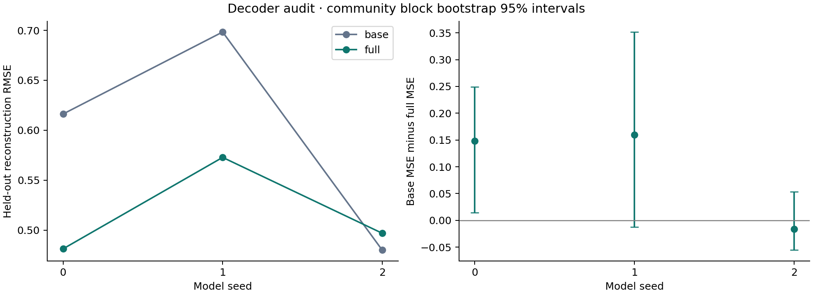
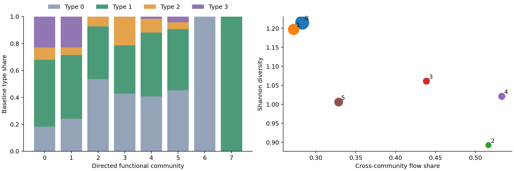
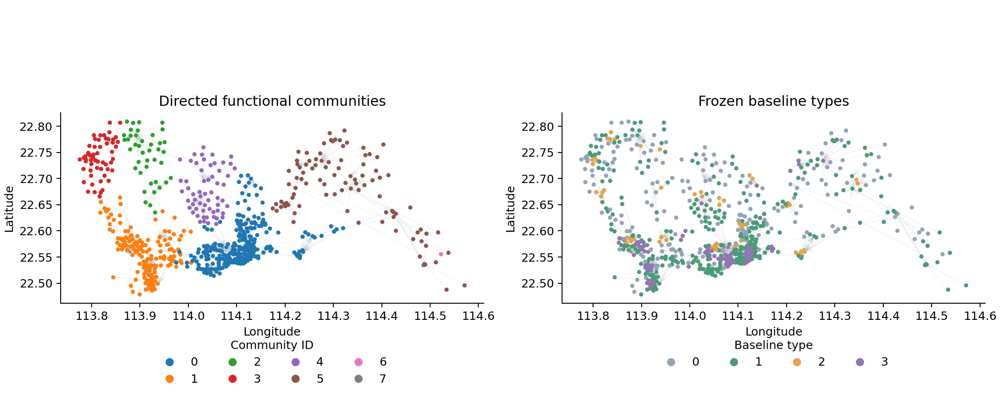

# 供给解码验证与有向功能社区分析

已完成三个种子的 checkpoint 重放、九维解码验证、冻结 PC 与类型规则下的重建诊断，以及加权有向社区发现。基于分支 experiment/redo-destpred 的 3463723e8fe425dc40e094a1ab0f5493032bbf3f。分析采用 E3_w1 的全部三个种子，没有依据本次测试结果挑选模型种子。

当前可以报告功能社区的供给组成与网络依赖。供给变化和类型转换暂保留为重建诊断，不用于社区韧性排序或因果解释。两个机制门也不作为已识别机制效应。

## 解码验证

三个 checkpoint 的预测得分和节点嵌入与归档逐值一致，CE、CPC、NRMSE 在 1e−12 容差内一致。九项指标、冻结变换、三个 PC 投影和四类配置中心全部沿用原 ruler。类型数实际为四类。

节点按原始供给类型分层拆分，399 个训练节点、133 个验证节点、134 个测试节点。三个模型种子使用完全相同的拆分。解码器只在训练节点拟合，正则化参数和解码器选择只使用验证节点。预训练图模型和冻结 ruler 已使用全市输入，因此这是解码器的传导式留出检验，并非整套图模型对未见社区的归纳验证。

主线性对照采用 Ridge，另比较一个 32 单元隐藏层的 MLP。只允许已收敛的候选进入选择。所有候选和收敛状态保存在 decoder_selection.csv。MLP 比较由线性验证误差触发，随后完整表示和本地表示使用相同候选解码器集合。

| 种子 | 线性完整表示测试 RMSE | 线性本地表示测试 RMSE | 验证所选完整表示测试 RMSE | 验证所选本地表示测试 RMSE |
| --- | ---: | ---: | ---: | ---: |
| 0 | 0.4813 | 0.5705 | 0.4813 | 0.6163 |
| 1 | 0.6154 | 0.7123 | 0.5728 | 0.6983 |
| 2 | 0.4952 | 0.5736 | 0.4969 | 0.4800 |

误差单位为冻结变换后的标准化指标单位。九项指标各自的 MAE、RMSE、R² 和 Pearson 相关系数见 decoder_performance.csv。预测误差以所有测试节点和九项指标等权计算。

完整表示在三个种子的线性对照中均降低重建误差。允许非线性本地解码后，种子 2 的完整表示不再优于本地表示。按主划分的功能社区进行 2000 次整块 bootstrap，所选本地解码 MSE 减完整解码 MSE 的 95% 区间分别为 0.0147 至 0.2491、−0.0125 至 0.3516、−0.0556 至 0.0532。后两个区间包含零。只有少量有效社区块，这些区间应作为探索性结果。

protocol.json 在解码前记录了探索性操作门槛，包括验证总体 RMSE 不超过 0.5、各指标验证 R² 为正、验证 MSE 相对改善超过 1% 和测试增量区间下限为正。种子 1 的验证 RMSE 为 0.5404，且种子 1、2 的增量区间不满足门槛。这些门槛不是已有领域公认标准，不应将其包装为正式统计验收。



## 供给变化的解释边界

当前解码训练目标是原始九项供给指标。因此 Decoder(h_full) 与 x_before 的差值，同时也是供给指标的重建残差。仅凭残差大小不能区分互动调整与解码误差，残差较小也不能独立证明社区更有韧性。

已按方案保存九项 before、after、同一解码器下的本地通道对照、三个 PC、连续距离和类型转换。文件名和列名统一标注 diagnostic。全样本诊断含训练节点，不能用全样本 retained 比例替代留出重建性能。通道置零只是表示消融，可能偏离训练表示分布，不是现实供给情景。

当前暂停供给变化的实质解释，保留全部数值以便复核。后续重点需要明确互动调整后供给的可验证估计目标或独立服务机会参照。不能把重建误差降低直接写成供给稳定性提高，也不能仅通过加大解码器拟合能力解决这一解释问题。

## 有向功能社区

使用阈值 2 后的原始有向 OD 流量，节点方向及边权保持不变。主算法为 Leiden 的 directed RBConfiguration objective，分辨率 1、随机种子 0，迭代至收敛。保留社区内部流，自环不进入外部消息。主划分包含 6 个有流量的功能社区和 2 个零流量孤立节点。孤立节点的对外依赖率记为空值，不解释为零依赖或高韧性。

| 功能社区 ID | 节点数 | 跨功能社区流量比例 | Shannon 多样性 |
| --- | ---: | ---: | ---: |
| 0 | 252 | 28.30% | 1.215 |
| 1 | 161 | 27.22% | 1.197 |
| 2 | 41 | 51.62% | 0.893 |
| 3 | 56 | 43.85% | 1.061 |
| 4 | 59 | 53.29% | 1.021 |
| 5 | 95 | 32.87% | 1.006 |

类型 0 为稀缺型，类型 1 为社康主导型，类型 2 为三甲二级型，类型 3 为三甲社康型。完整中文名称沿用 ruler，见 protocol.json。社区 0、1 的供给类型相对多样，社区 2、4 的外部依赖较高。这是当前网络下的描述性关系，不能据此断言多样性提高韧性。社区内流量比例也是 OD 社区发现目标相关的结果，不是独立的韧性验证证据。





网络图仅绘制每个起点的最大外流边作为展示骨架。社区划分使用全部阈值后边。节点颜色分别对应功能社区和冻结供给类型，空间位置来自原始社区坐标。该图不包含行政边界。

同一分辨率的 5 个种子均得到 6 个有流量社区。相对主划分的 ARI 为 0.918 至 1.000。分辨率 0.75 得到 4 个有流量社区，分辨率 1.25 得到 7 至 8 个。阈值改为 1 或 3 后仍为 6 个有流量社区，相对主划分的 ARI 分别为 0.914 和 0.961。零流量孤立节点数量随阈值变化，已与有流量社区数量分开报告。

## 交付物与重放

完整结果在 complete_results.zip 中，解压后包含每个节点和模型种子的供给诊断、类型转换、功能社区组成、跨社区流量矩阵、敏感性划分、解码器参数、固定节点拆分和输入哈希。关键表格和图同时直接保存在本目录。原实验与归档未改动。

从原实验 archives 恢复 E3_w1 的三个种子后，在仓库根目录执行以下命令。输出目录必须尚不存在，以免覆盖已有结果。

```bash
python 5lineb/v13_geoflow/analyze_supply_followup_v13.py --output /path/to/new_results
```

依赖包括 PyTorch、scikit-learn、python-igraph 和 leidenalg，精确版本见 manifest.json。decoder_seed*.npz 保存标准化参数及线性或 MLP 权重，使用 NumPy 可重放。阶段 A 与阶段 C 的描述性分析已完成，阶段 B 的数值诊断已保存，阶段 D 的供给变化与韧性结论受上述验证边界限制。
